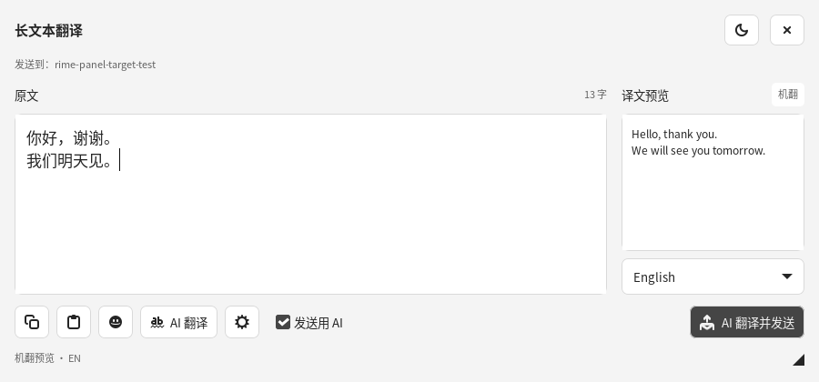
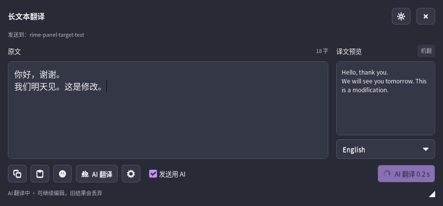

# Rime LLM Translator

[English](README.md) · [简体中文](README_CN.md) · [繁體中文](https://github.com/LE-saber/rime-llm-translator/blob/main/README.zh-TW.md) · [日本語](https://github.com/LE-saber/rime-llm-translator/blob/main/README.ja.md) · [下载 v0.3.0 正式版](https://github.com/LE-saber/rime-llm-translator/releases/tag/v0.3.0) · [更新记录](CHANGELOG.md)

为 **Ubuntu 24.04 amd64、GNOME 46、IBus / 朙月拼音**提供轻量离线翻译、可编辑长文本悬浮框和可选云端 AI。保留普通中文及繁体输入。本版本不支持 Windows，其他桌面环境不在支持范围内。

普通打字即可出现英、日机翻候选；长文本可在悬浮框中选词、修改，再将译文发送到真实输入框。程序使用原生 GTK3、C / IBus 与 CPU Bergamot INT8，共用一个离线计算进程。安装包包含模型，无需 pip、GPU、本机编译或首次下载权重。

## 界面演示

大原文编辑区、小型语言预览、图标工具和可关闭的“发送用 AI”开关：



Dracula 夜间主题；等待 AI 发送时，按钮显示转圈和耗时秒数：



[夜间完整界面](docs/images/long-text-dark.png) · [GUI 设置](docs/images/settings.png)。图片来自 GitHub Actions 的真实 GTK 程序，使用公开测试文本与本地模拟 AI 接口，用于展示界面和交互。

## 安装与升级

从 [v0.3.0 Release](https://github.com/LE-saber/rime-llm-translator/releases/tag/v0.3.0) 下载 `.deb` 和 `SHA256SUMS`，放入同一目录：

```bash
sha256sum --check SHA256SUMS
sudo apt install ./rime-llm-translator_0.3.0_amd64.deb
```

新用户运行：

```bash
rime-llm-translator setup && rime-llm-translator enable
```

旧版本升级运行以下命令，保留 API Key、模型、快捷键等配置：

```bash
rime-llm-translator sync && rime-llm-translator enable
```

除 APT 外，均使用桌面普通用户。**注销并重新登录**，在设置 → 键盘 → 输入源 → 中文中添加 **Rime Translator** 并切换过去；必要时按 Ctrl+反引号选择朙月拼音。

`sync` / `enable` 安装当前用户的 GNOME 桥接扩展。如果全局禁用了用户扩展，需在 GNOME Extensions 中启用。运行 `rime-llm-translator doctor`，确认 `GNOME floating-panel bridge` 为 `active`。

原生 Rime 输入源独立保留，新入口使用 `~/.config/ibus/rime-llm`，不会复制或同时打开原生词频数据库。只用离线英日翻译可不填密钥。应用列表提供设置入口，也可运行 `rime-llm-translator settings` 打开 GUI。

## 怎样使用

| 操作 | 效果 |
|---|---|
| 正常拼音输入 | 保留中文候选，后台补充 `🌐 MT · EN/JA`，无需额外按键刷新 |
| AI 快捷键，默认 Ctrl+Shift+Enter | 对选中的中文候选请求云端修正，显示 `✦ AI · EN/JA`，不自动上屏 |
| 打开长文本，默认 Alt+Space | 打开空白、置顶、可拖动缩放的悬浮框；原候选只保存进记录 |
| 在悬浮框选词、编辑 | 中文累积到可编辑原文区，旁边实时机翻预览 |
| 发送，默认 Ctrl+Enter | 当前预览语言的译文写入最近选择的真实输入框，成功后清空 |
| 原文为空时按 ↑ / ↓ | 依次回溯最近文本，包括关闭前未发送的内容 |

**发送位置跟随最近选择的真实文本框。** 从 A 打开，期间点击 B 放入文本光标，再回悬浮框编辑，译文会发往 B；未改选则仍是 A。同窗口中的不同输入框也适用。悬浮原文区和本程序设置框始终排除。顶栏显示目标窗口，提交时恢复并核对目标；目标关闭、失效或发送失败会保留原文。不使用全局粘贴或模拟打字提交。

**实时预览使用离线机翻。填写 API 地址、模型和非空密钥后，“发送用 AI”默认生效，可手动关闭。** 手动 AI 仅处理当前文本和语言；改字、换语言、成功发送后回到机翻预览。等待时显示转圈与秒数；失败、超时、截断或过期结果不会被机翻悄悄替代。只有主动请求 AI 或开启 AI 发送后执行发送，才将文本上传至配置的服务。

GUI 支持录制快捷键、双 / 三击 Alt 和面板内鼠标侧键。**Alt+Space 可能被 GNOME 窗口菜单占用**，可改录未占用的 Ctrl+Alt+Space 等组合。打开依赖 Rime Translator 收到键盘事件，不是全局桌面快捷键。CLI 修改候选 AI 快捷键：

```bash
rime-llm-translator hotkey DoubleAlt
```

选中未上屏中文候选，在 400 ms 内完整点按同一个 Alt 两次；按住、夹入其他键或切换焦点会取消手势。宿主机 / 桌面快捷键可能提前拦截按键。详细操作见 [长文本说明与验收](docs/LONG_TEXT.md)。

## 性能、隐私与限制

- 原生计算进程单线程，默认最多使用一个逻辑核，较低 CPU 优先级；一次只驻留一个模型方向，空闲 60 秒退出。面板按需启动，不引入 Electron 或浏览器运行时。
- 中英使用 tiny 模型，日文经英文中转，定位为基本草稿。OpenCC 只转换机翻副本，AI 收到原始中文。上游 tiny 模型尚未标记为 Release，专名、数字、否定等需人工检查。
- 虚拟机 CPU 需要暴露 SSE4.1。普通候选源文本上限 1,200 UTF-8 字节，长文本上限 32 KiB，按顺序分块翻译。离线支持英、日，其他配置语言需要 AI。
- MT / AI 独立服务，各自缓存最多 350 项、10 MiB。日志不记录正文、译文或密钥。可选本机输入记录最多 50 条去重，可关闭或清空。

Release 附有 `RESOURCE_REPORT.md` 和 `mt-benchmark.json`，记录实际包大小、项目解压磁盘、内存、冷 / 热延迟和公开样本译文。系统依赖另计，GitHub runner 测量不能代表用户虚拟机速度。

## 诊断与旧版清理

```bash
rime-llm-translator doctor
rime-llm-translator install-offline        # 校验包内引擎与模型
rime-llm-translator cleanup-legacy         # 仅查看旧私有环境 / 临时目录
rime-llm-translator cleanup-legacy --apply # 删除选中的旧残留
```

清理保留密钥、配置、记录和 Rime 词库；共享 pip 缓存、Argos 模型需要单独选项。见 [升级与清理](docs/UPGRADE_CLEANUP.md)、[手动验收](docs/MANUAL_TEST.md)、[开发与构建](docs/DEVELOPMENT.md) 和 [更新记录](CHANGELOG.md)。

GitHub Actions 在 Ubuntu 24.04 运行单元测试、包安装、真实 Rime / IBus / GTK、GNOME 46 Wayland 焦点与发送、模拟 AI 故障及断网模型测试；不使用 WSL。实际云端质量和用户虚拟机 / 应用仍需手动验收。

## 源码与许可

前端基于 GPLv3-or-later [ibus-rime 1.5.0](https://github.com/rime/ibus-rime/tree/d525f18b45123869af0055cc8402d459ebdbb9e3)，源码和许可位于 [frontend/](frontend/) 及安装包。Mozilla 推理依赖完整源码和许可随包提供于 `/usr/share/doc/rime-llm-translator/inference-source.tar.xz`，并附包装代码与锁定修订。Mozilla 模型按 MPL 2.0 分发，校验值和许可在 [models.lock.json](native/mt/models.lock.json)；第三方组件保留各自许可。根目录 Ollama Lua 为未参与安装运行的上游原型。
